# Pacote de impactos animados — 18 tipos

**Clique em qualquer GIF para vê-lo individualmente.** As animações abaixo reproduzem diretamente nesta página do GitHub, sem instalação, download ou player externo.

> Estudos autorais em revisão visual, não integrados ao Pokémon Torre 2. Quatro efeitos originais anteriores preservados; 14 criados neste lote.

### Normal

[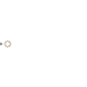](./normal-hit.gif)  
[Spritesheet PNG](./normal-hit.png)

### Fogo

[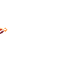](../hns-impact-studies/ember-hit.gif)  
[Spritesheet PNG](../hns-impact-studies/ember-hit.png)

### Água

  
[Spritesheet PNG](../hns-impact-studies/tide-hit.png)

### Elétrico

[](../hns-impact-studies/volt-hit.gif)  
[Spritesheet PNG](../hns-impact-studies/volt-hit.png)

### Planta

  
[Spritesheet PNG](./grass-hit.png)

### Gelo

[](../hns-impact-studies/frost-hit.gif)  
[Spritesheet PNG](../hns-impact-studies/frost-hit.png)

### Lutador

[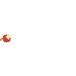](./fighting-hit.gif)  
[Spritesheet PNG](./fighting-hit.png)

### Veneno

[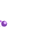](./poison-hit.gif)  
[Spritesheet PNG](./poison-hit.png)

### Terra

[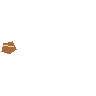](./ground-hit.gif)  
[Spritesheet PNG](./ground-hit.png)

### Voador

[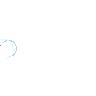](./flying-hit.gif)  
[Spritesheet PNG](./flying-hit.png)

### Psíquico

[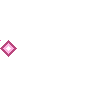](./psychic-hit.gif)  
[Spritesheet PNG](./psychic-hit.png)

### Inseto

  
[Spritesheet PNG](./bug-hit.png)

### Pedra

  
[Spritesheet PNG](./rock-hit.png)

### Fantasma

[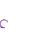](./ghost-hit.gif)  
[Spritesheet PNG](./ghost-hit.png)

### Dragão

[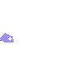](./dragon-hit.gif)  
[Spritesheet PNG](./dragon-hit.png)

### Sombrio

[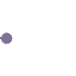](./dark-hit.gif)  
[Spritesheet PNG](./dark-hit.png)

### Aço

[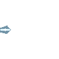](./steel-hit.gif)  
[Spritesheet PNG](./steel-hit.png)

### Fada

[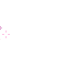](./fairy-hit.gif)  
[Spritesheet PNG](./fairy-hit.png)

[Detalhes técnicos](../../docs/TYPE-IMPACT-PACK-18-2026-11-16.md) · [Visualizador HTML](../../type-impact-lab.html)
